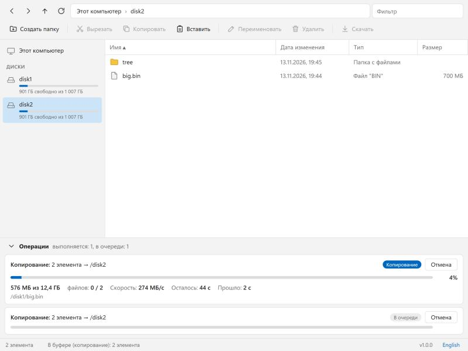

# Linux File Explorer

Веб-проводник в стиле Windows для Linux-серверов и роутеров (OpenWrt): копирование и перемещение
больших файлов и папок внутри одного диска и между дисками — с очередью операций, прогрессом,
скоростью и отменой.

*A Windows-Explorer-style web file manager for Linux boxes and OpenWrt routers. Copy/move big files
between disks with a sequential job queue, live progress, speed and cancel. One static binary
(~6 MB), runs in Docker or standalone. UI: Russian / English. [English quick start](#english-quick-start).*



## Возможности

- **Проводник**: диски слева (с заполненностью), адресная строка, сортировка, фильтр, выделение
  Ctrl/Shift, контекстное меню, горячие клавиши (Ctrl+C / X / V / A, Del, F2, Enter, Backspace, Пробел).
- **Перетаскивание** мышью на папку, диск или элемент адресной строки: в пределах диска — перемещение,
  на другой диск — копирование (Ctrl — всегда копировать, Shift — всегда переместить).
- **Очередь операций**: копирование, перемещение и удаление встают в очередь и выполняются строго по
  одной — диски не «дерутся» за головки и скорость не падает.
- **Секция «Операции»**: общий объём, процент, скорость, оставшееся время, число файлов, текущий файл,
  кнопки «Пауза» / «Продолжить» и «Отмена» (и для выполняющейся, и для ожидающей операции),
  список ошибок.
- **Конфликты имён**: «Заменить», «Пропустить» или «Сохранить оба» (папки при этом объединяются).
- **Свойства** (кнопка на панели, контекстное меню или клавиша Пробел): размер, число файлов и папок
  для выделенного или для открытой папки — с живой индикацией подсчёта; для одного элемента ещё тип,
  дата создания и дата изменения. Размер папки после подсчёта показывается и в колонке «Размер».
- Список файлов и диски обновляются сами: после каждой операции, во время копирования в открытую
  папку и при изменениях, сделанных другими программами или в другой вкладке.
- Создание папок, переименование, удаление, скачивание файла в браузер.
- Скрытые файлы (имя начинается с точки) по умолчанию не показываются; включаются флажком
  «Показывать скрытые файлы» в строке состояния.
- Необязательная защита паролем (HTTP Basic).
- Один статический бинарник без зависимостей: amd64, arm64, armv7, armv5, mips, mipsle.

## Почему это быстро

- Перемещение в пределах одного диска — это мгновенный `rename()`, без копирования данных.
- Копирование идёт внутри ядра, без перекачки данных через программу: сначала `copy_file_range()`
  (на btrfs/XFS это мгновенный reflink), если он недоступен — `sendfile()`, и только в крайнем случае
  обычное чтение/запись блоками по 1 МБ. На слабых процессорах роутеров это заметно быстрее `cp`/`rsync`.
- Для больших файлов данные сбрасываются на диск по ходу копирования (`sync_file_range`), поэтому
  память роутера не забивается кэшем, а скорость и процент показывают реальную запись на диск,
  а не «100 % за секунду, а потом минута ожидания».
- Файл пишется во временное имя `.lfe-*.part` и переименовывается только после успешного завершения:
  при отмене или сбое недописанных файлов под настоящим именем не остаётся.
- В конце операции выполняется `syncfs()` — когда операция «Готово», данные действительно на диске.

## Установка на OpenWrt (Docker)

Нужен установленный Docker и смонтированные диски (обычно в `/mnt/sda1`, `/mnt/sdb1`…):

```sh
# OpenWrt 24.10 и старше
opkg update && opkg install dockerd docker block-mount
# OpenWrt 25.x
apk update && apk add dockerd docker block-mount
```

**1. Собрать образ** (компилятор не нужен — скачивается готовый бинарник под процессор роутера):

```sh
wget -O- https://raw.githubusercontent.com/rus15183/linux-file-explorer/main/Dockerfile.prebuilt | docker build -t lfe -
```

**2. Запустить:**

```sh
docker run -d --name lfe --restart unless-stopped -p 8080:8080 -v /mnt:/mnt lfe
```

**3. Открыть** `http://<адрес-роутера>:8080` (например `http://192.168.1.1:8080`).

Всё, что лежит в `/mnt` роутера, появится в интерфейсе: каждая папка верхнего уровня — «диск».

### Варианты запуска

С паролем:

```sh
docker run -d --name lfe --restart unless-stopped -p 8080:8080 -v /mnt:/mnt -e LFE_USER=admin -e LFE_PASSWORD=change-me lfe
```

Диски в разных местах — монтируйте каждый в свою папку внутри `/mnt` контейнера:

```sh
docker run -d --name lfe --restart unless-stopped -p 8080:8080 -v /mnt/sda1:/mnt/usb -v /overlay/share:/mnt/share lfe
```

Чтобы видеть диски, подключённые **после** запуска контейнера (горячее подключение USB):

```sh
mount --make-rshared /
```

```sh
docker run -d --name lfe --restart unless-stopped -p 8080:8080 -v /mnt:/mnt:rslave lfe
```

(первую команду добавьте в `/etc/rc.local`, чтобы она выполнялась при загрузке).

Если страница не открывается из локальной сети (firewall OpenWrt не пропускает трафик к docker-сети) —
запустите с сетью хоста, слушая только LAN-адрес роутера:

```sh
docker run -d --name lfe --restart unless-stopped --network host -e LFE_LISTEN=192.168.1.1:8080 -v /mnt:/mnt lfe
```

Есть и [docker-compose.yml](docker-compose.yml): `docker compose up -d`.

### Обновление

```sh
wget -O- https://raw.githubusercontent.com/rus15183/linux-file-explorer/main/Dockerfile.prebuilt | docker build --no-cache -t lfe -
```

```sh
docker rm -f lfe
```

и снова команда запуска.

## Без Docker

Программа — один файл, Docker не обязателен. Возьмите бинарник под свой процессор из
[Releases](https://github.com/rus15183/linux-file-explorer/releases/latest)
(`uname -m`: `aarch64` → arm64, `armv7l` → armv7, `x86_64` → amd64, `mips` → mips, `mipsel` → mipsle):

```sh
wget -O /usr/bin/lfe https://github.com/rus15183/linux-file-explorer/releases/latest/download/lfe-linux-arm64
chmod +x /usr/bin/lfe
lfe -root /mnt -listen :8080
```

Автозапуск на OpenWrt — файл `/etc/init.d/lfe`:

```sh
#!/bin/sh /etc/rc.common
START=95
USE_PROCD=1
start_service() {
    procd_open_instance
    procd_set_param command /usr/bin/lfe -root /mnt -listen :8080
    procd_set_param respawn
    procd_close_instance
}
```

```sh
chmod +x /etc/init.d/lfe && /etc/init.d/lfe enable && /etc/init.d/lfe start
```

## Настройки

| Переменная     | Флаг        | По умолчанию | Описание                                                        |
|----------------|-------------|--------------|-----------------------------------------------------------------|
| `LFE_ROOT`     | `-root`     | `/mnt`       | Папка, которая показывается в интерфейсе как «Этот компьютер»   |
| `LFE_LISTEN`   | `-listen`   | `:8080`      | Адрес и порт веб-интерфейса                                     |
| `LFE_USER`     | `-user`     | —            | Логин (включает HTTP Basic авторизацию)                         |
| `LFE_PASSWORD` | `-password` | —            | Пароль                                                          |
| `LFE_SYNC`     | —           | `1`          | `0` — не сбрасывать данные на диск принудительно (см. ниже)     |

## Важно знать

- **Безопасность.** По умолчанию пароля нет, а программа может удалять и перезаписывать всё в
  смонтированных папках. Не открывайте порт в интернет; для доступа снаружи используйте VPN.
  Авторизация Basic без HTTPS защищает только от случайного доступа в локальной сети.
- **Мгновенное перемещение** работает, когда источник и назначение находятся в одной точке
  монтирования. Если две папки одного диска примонтированы в контейнер по отдельности
  (`-v /mnt/sda1/a:/mnt/a -v /mnt/sda1/b:/mnt/b`), перемещение между ними пойдёт копированием —
  монтируйте диск целиком.
- **Перемещение между дисками** = копирование + удаление исходного файла сразу после его успешной
  копии. При отмене уже перенесённые файлы остаются на новом месте, остальные — на старом.
- **Пауза.** Выполняющаяся операция на паузе остаётся первой в очереди: следующие ждут, пока её не
  продолжат или не отменят. Ожидающая операция на паузе просто пропускается, пока её не продолжат.
  Копирование останавливается в пределах 4 МБ; сброс на диск в конце операции не прерывается.
- **Очередь хранится в памяти**: после перезапуска контейнера незавершённые операции не продолжаются
  (недописанный файл `.lfe-*.part` можно удалить вручную).
- **FAT/exFAT/NTFS** не хранят права и владельцев Linux, символические ссылки на них не создаются —
  такие элементы попадут в список ошибок операции, остальное скопируется.
- **NTFS**: используйте драйвер ядра `ntfs3` (`kmod-fs-ntfs3`), он в разы быстрее `ntfs-3g`.
- `LFE_SYNC=0` отключает принудительный сброс на диск: цифры скорости будут выше, но это запись в
  кэш; после «Готово» данные ещё какое-то время дописываются, не выдёргивайте диск сразу.
- Специальные файлы (устройства, сокеты, FIFO) не копируются.
- **Дата создания** в «Свойствах» показывается, если её хранит файловая система (ext4, btrfs, XFS,
  NTFS, exFAT). Linux не позволяет её задать, поэтому у копии это момент копирования; дата
  изменения при копировании сохраняется.

## Сборка из исходников

```sh
docker build -t lfe https://github.com/rus15183/linux-file-explorer.git
```

Или бинарники под все платформы (нужен Go 1.23+): `./build.sh 1.0.0` → папка `dist/`.

Зависимости: только стандартная библиотека Go и `golang.org/x/sys`. Интерфейс — чистые HTML/CSS/JS
без фреймворков, вшит в бинарник.

## English quick start

```sh
wget -O- https://raw.githubusercontent.com/rus15183/linux-file-explorer/main/Dockerfile.prebuilt | docker build -t lfe -
```

```sh
docker run -d --name lfe --restart unless-stopped -p 8080:8080 -v /mnt:/mnt lfe
```

Open `http://<host>:8080`. Every top-level folder of `/mnt` is shown as a disk. Optional auth:
`-e LFE_USER=admin -e LFE_PASSWORD=secret`. Without Docker: download a binary from
[Releases](https://github.com/rus15183/linux-file-explorer/releases/latest) and run `lfe -root /mnt -listen :8080`.

Jobs (copy / move / delete) are queued and run one at a time. Moves within one filesystem are an
instant `rename()`; copies use `copy_file_range()` → `sendfile()` → read/write fallback, write to a
temporary `.lfe-*.part` file and rename on success. There is no auth by default — do not expose it to
the internet.

## Лицензия

[MIT](LICENSE)
